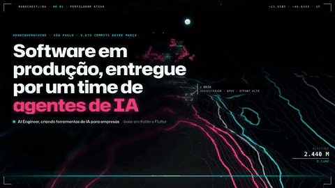
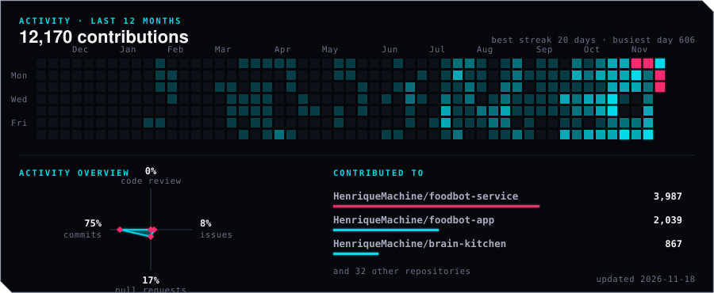

<a href="https://henriquemachine.github.io"><b>▶ Descer a montanha</b></a> · the crew, the gates and the harness as a scroll journey (pt-BR)

## Shipping production software with a team of AI agents

**AI Engineer, building enterprise AI tooling** · Kotlin & Flutter background · São Paulo

> **The human owns the direction, the product and the quality. The agent implements.**
> The human spends attention where it is worth the most: at the start (what to build) and at the end (the review by risk). The middle belongs to the harness.

> 🇧🇷 **Resumo:** Toco o FoodBot, um SaaS para restaurantes de delivery, em produção, com um time de agentes de IA em 11 papéis. *O humano é dono da direção, do produto e da qualidade. O agente implementa.* A página [A Descida](https://henriquemachine.github.io) conta tudo em português.

 

### 🧑‍🍳 What I'm building: FoodBot

A SaaS for delivery restaurants in Brazil: orders, reviews, menu, stock and payouts in one place, with Burg, its virtual assistant. 👉 [foodbotbrasil.com.br](https://foodbotbrasil.com.br)

| | |
|---|---|
| **Stack** | Kotlin · Ktor · Exposed · PostgreSQL · Redis · Flutter Web · Riverpod · AWS (ECS Fargate, RDS) · Claude |
| **Codebase** | ~3,000 Kotlin files in 17 Gradle modules · ~1,600 Dart files · 199 Flyway migrations · 2,500+ app tests |
| **Pace** | 8,679 commits since March 2026 · ~1,400 merged PRs in the last 30 days |

The code is private. The workflow is not: I am opening it as a template (see below).

 

### ᚨ The crew

Eleven roles, one owner each. Nobody merges their own code, and only the human touches production.

| Rune | Agent | Role | Model · effort |
|:---:|---|---|---|
| ᚨ | **Odin** | Orchestrator: plans the version, writes the tickets, never edits code | Opus · high |
| ᛉ | **Heimdall** | Backend gate: reviews and merges backend PRs, owns the migrations | Opus · high |
| ᛏ | **Forseti** | App gate: design fidelity, reviews and merges app PRs | Opus · high |
| ᛚ | **Mímir** | AI full-stack: the assistant, calibration, pricing, the eval lab | Opus · high |
| ᚲ | **Eitri** | Backend executor: Kotlin features, test first | Opus · medium |
| ᚷ | **Völundr** | App executor: Flutter screens from the approved design | Opus · medium |
| ᚱ | **Bifröst** | Integrations: delivery-platform APIs, WhatsApp bot, landing, alerts | Opus · medium |
| ᚹ | **Bragi** | Words and product: every sentence a customer reads, checked against the code | Sonnet · medium |
| ᚺ | **Níðhöggr** | Code health: dead code, refactors, new regression tests | Sonnet · medium |
| ᚠ ᛇ | **Brokkr · Egill** | Code helpers: one well-defined fix or screen, with tests | Sonnet · medium |
| ᚢ | **Grisnir · Gnjóstr** | Mechanical helpers: tests, regression suite, search. Read-only tools | Haiku · low |

**The rule for models:** the more a wrong answer costs, the stronger the model and the higher the effort. Decisions and gates get the most; mechanical work gets the least.

 

### 🌉 How a change ships: six gates

| Gate | Owner | What happens |
|---|---|---|
| **G1 · Ticket ready** | Odin | Goal, likely files, acceptance criteria, the command that proves it |
| **G2 · Build** | the executor | Test first, then code, in its own git worktree |
| **G3 · Candidate** | a script | Format, changed tests, migration number and PR template, before anyone reads it |
| **G4 · Review** | Heimdall · Forseti · Bragi | Backend, app, and every customer-facing sentence |
| **G5 · Merge train** | the gates | Approved PRs ride together: one full verification for the batch, the culprit isolated if it fails |
| **G6 · Regression** | Grisnir · Gnjóstr | The regression suite on the merged batch |
| **▲ Release** | the human | Every production step waits for an explicit yes |

A failure sends the change back one gate, never to the start.

 

### 🛡️ The harness

| | |
|---|---|
| **Governance** | **Gleipnir**, a `PreToolUse` hook, blocks `main`, deploys, secrets and production writes. Only the two gates merge to `develop`. |
| **Cost** | Model and effort per role, cached prompts, one full verification per merge batch, and `heavy`: a FIFO queue for heavy commands. |
| **Quality** | Tests first, six gates on every change, and the product's own AI scored in an eval lab before a prompt ships. |
| **Orchestration** | **Yggdrasil** (the Obsidian vault) holds one note per agent. Agents talk in four message types: `DONE / ASK / BLOCK / FYI`. **Ratatoskr** carries the notifications; **Huginn and Muninn** report on the status panel. One worktree per ticket. |

 

### 📚 Influences

- [**Rethinking Claude Code Best Practices**](https://www.youtube.com/watch?v=vlfCjWuv4es) · Lydia Hallie, Anthropic. *A hard rule only for what you can't take back.* That is why Gleipnir guards only main, deploys, secrets and production writes.
- [**Full Walkthrough: Workflow for AI Coding**](https://www.youtube.com/watch?v=-QFHIoCo-Ko) · Matt Pocock. *Align with the human first, slice the work, keep the feedback tight.* That is why every plan starts with a round of questions and every ticket carries its blockers.

 

### 🛠️ Open source & projects

| Project | What it is |
|---|---|
| [RuneChest](https://github.com/HenriqueMachine/RuneChest) | A keyboard-driven terminal workspace for running a team of AI coding agents: Ghostty, Zellij, Neovim and the crew panel |
| 📦 *Agent team template* | The roles, contracts, protocol and guardrails above, for Claude Code. Coming soon |
| [EasyFingerPrint](https://github.com/HenriqueMachine/EasyFingerPrint) | Android fingerprint authentication library · Material Design |
| [distributed-consistency-jvm](https://github.com/HenriqueMachine/distributed-consistency-jvm) | Sagas and failure as part of the flow, in Kotlin |
| [sdui-backend](https://github.com/HenriqueMachine/sdui-backend) · [sdui-app](https://github.com/HenriqueMachine/sdui-app) | Server-driven UI: a Ktor backend and a Flutter renderer with a shared JSON Schema contract |
| [Pokedex](https://github.com/HenriqueMachine/Pokedex) | Android with Clean Architecture · Compose · Paging 3 |
| [OdinEngine](https://github.com/HenriqueMachine/OdinEngine) | Personal DevX CLI toolkit in Go |

 

### 🧰 Stack

### 📈 Activity

<code>$ cat stats.log</code> · more stats, updated daily

 

 

**📫 Connect** ·  
